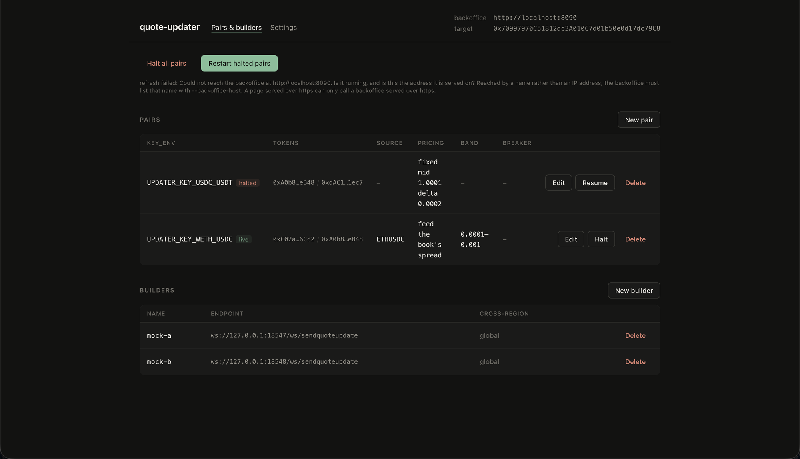

# backoffice-ui

A front end for the updater's backoffice API ([docs/manual.md](../docs/manual.md), "The
backoffice"): a page that reads and changes the pairs and builders through `/api`, and
nothing else. Plain JavaScript modules (`js/`), `index.html` and `style.css`, with no
runtime dependencies; [pnpm](https://pnpm.io) and Vite serve them in development and build
them into `dist/`, static files to deploy. The page loads nothing from anywhere but its own
directory and the backoffice.



```bash
pnpm install       # Vite, and the Node version package.json pins (devEngines)
pnpm dev           # http://127.0.0.1:8090, /api proxied to http://127.0.0.1:8088
pnpm build         # dist/
```

What it does, each through the route named:

| Page | What it does |
|---|---|
| Pairs & builders | every pair with its status (`live`, `halted`, `breaker tripped`, `not running`), refreshed every 5s; halt, resume and delete one; re-arm one its breaker tripped (`POST /api/pairs/{key_env}/rearm`); halt all (`POST /api/halt`); restart halted pairs (`POST /api/reload`, which re-arms nothing); every builder, and delete one |
| New pair, Edit | the pair's stanza as a form: tokens and `key_env`, the venue table, the bounds and the breaker, the pricing kind and its fields (`GET /api/kinds`), the guards, `allow_symbol_mismatch` |
| New builder | `name`, `endpoint`, `api_key` and `disable_cross_region` (`POST /api/builders`) |
| Settings | `target` and `[settings]`, read-only, and which backoffice this page talks to |

The venue table is live. Once both token addresses are in, `GET /api/lookup` fills in
which exchanges list the pair, how each spells it, a weight from volume, and the volume.
Each ticked venue then gets a live mid over the preview websocket (`GET /api/preview`), with
the composite that would be published. On a new pair the lookup ticks the three venues with
the most volume; on a saved one it keeps the venues the pair has.

An edit sends back the stanza the API answered, with only the keys the form has an input for
changed, so a key it has no input for (a pricing key no field names, say) is kept, and
opening a pair and saving it changes nothing. The request a save will send is under "The
request", above the save button. Every answer is shown as it came: `applied` in green,
`partial` (kept, but some pair still runs its previous config) in amber, a refusal in red
with the API's own words.

## Developing

`pnpm dev` serves the page on `http://127.0.0.1:8090` and proxies `/api`, the preview's
websocket included, to the backoffice at `BACKOFFICE_API` (default
`http://127.0.0.1:8088`, the one `make quickstart` runs; `make backoffice-ui` is `pnpm
install` and `pnpm dev`). Page and API then share an origin, so the backoffice needs nothing
listed: the proxy keeps the `Host` the browser sent, an IP address, which the backoffice
answers to, and the page's `Origin` names that same address. The dev server listens on
loopback only, and should stay there: it is a way into an API with no login.

```bash
BACKOFFICE_API=http://100.64.1.2:8088 pnpm dev
```

## Deploying

`pnpm build` writes `dist/`: `index.html`, the bundled script and stylesheet under
`assets/`, and `config.json`, copied as it is so it can be edited where it is deployed. It
says where the API is:

```json
{ "api": "https://pusher.your-tailnet.ts.net:8088" }
```

Blank (as shipped) means the page's own origin: the page and `/api` served under one
address. The settings page can point one browser at another backoffice; that is saved in the
browser only, and "blank" there goes back to `config.json`'s.

The backoffice refuses a change from a page on an origin it does not know, and a browser
lets a page read the API's answers only if the API approves its origin (audit F-02). So
serve `dist/` one of two ways:

**Under the backoffice's own address**, from a reverse proxy that serves `dist/` and passes
`/api` (and its websocket) through. Nothing to list for CORS; leave `api` blank. The proxy
must pass `Host` and `Origin` through unchanged, as Caddy does, and the name it is reached by
must be listed with `--backoffice-host`:

```
pusher.your-tailnet.ts.net {
	reverse_proxy /api/* 100.64.1.2:8088
	root * /srv/backoffice-ui/dist
	file_server
}
```

**From another origin**, with any static file server, and that origin listed with
`--backoffice-cors-origin` (`BACKOFFICE_CORS_ORIGINS`) exactly as the browser's address bar
shows it: scheme, host and port, no path. `http://127.0.0.1:8080` and
`http://localhost:8080` are different origins. Set `api` in `dist/config.json` to the
backoffice's address:

```bash
python3 -m http.server 8080 --bind 100.64.1.2 --directory dist
quote-updater --config config.toml --backoffice-ip 100.64.1.2 \
  --backoffice-cors-origin http://100.64.1.2:8080
```

A page served over `https://` can only call a backoffice served over `https://` (the browser
blocks mixed content), so serve the backoffice with its certificate and list the page's
`https://` origin. Opened as a file (`file://`) the page cannot work: its origin is `null`,
which the backoffice never approves.

When the page cannot reach the API, the banner says so and names the likely cause: the
backoffice is down, the page's origin is not listed, the name it is reached by is not listed
with `--backoffice-host`, or an `https://` page is calling an `http://` backoffice.

## What it does not do

- **Guards are JSON.** No route lists the guard kinds a binary registers, so a pair's
  `[[pairs.guards]]` are edited as a JSON list, each with its `kind`.
- **A pricing kind with no fields is JSON too**: the rest of its stanza, as an object.
- **Settings are read-only.** The updater reads them once, at start; change `config.toml` and
  restart.
- **A new `key_env` needs a restart.** The updater reads its environment once, at start, so a
  pair on a key that is not in it yet is refused until the key is added and the updater
  restarted.
- **No login.** The API has none, so neither does this page. Anyone who can load it and reach
  the backoffice can change the pairs; serve both on the tailnet only.

What the page does to keep from being turned against the API it drives: it loads nothing
from another site (its `Content-Security-Policy` allows scripts and styles from its own
directory only), it puts everything the API and the exchanges answer into the page as text,
except a pricing kind's help, which the binary writes as HTML and which goes through an
allowlist of tags first, and a builder's `api_key` is sent once and never shown again (the
API never answers it).
